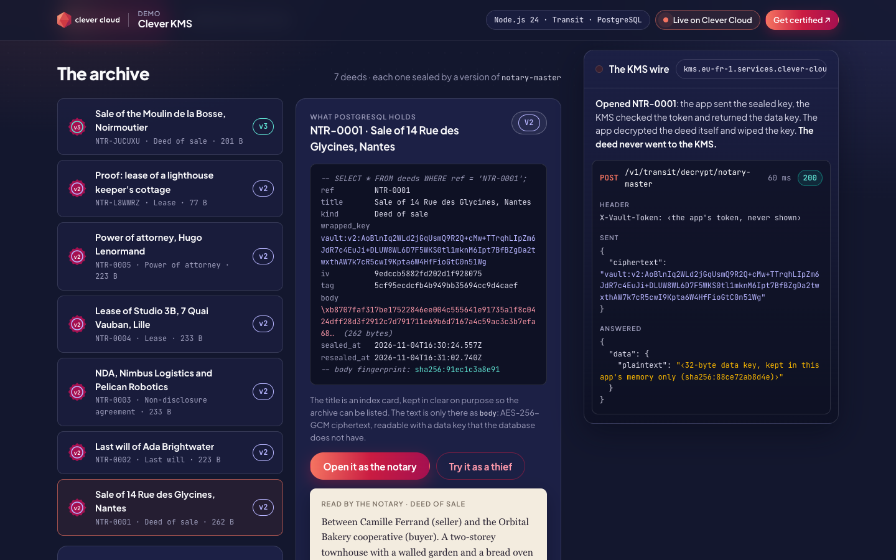
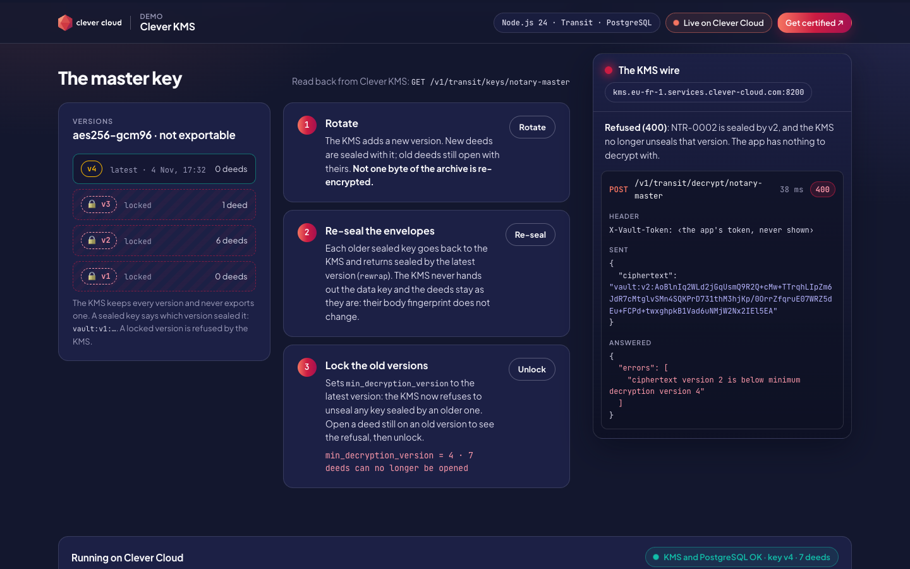
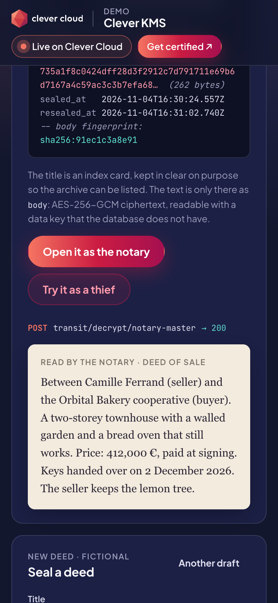
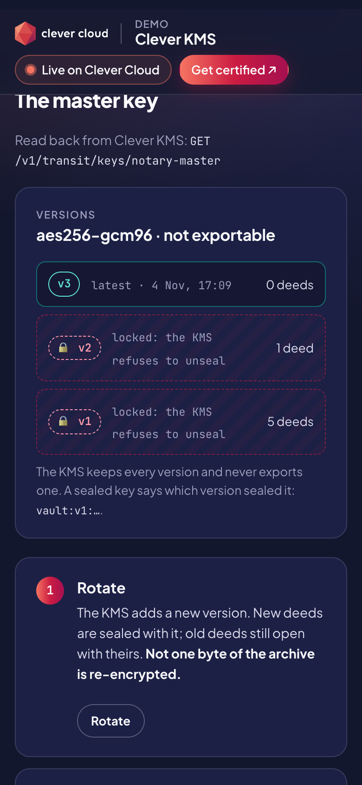

# The Notary — Clever KMS on Clever Cloud

> A notary's archive where **every deed has its own key**. When you seal a deed, the app asks **Clever KMS** for a fresh 256-bit data key, encrypts the deed with it, stores the key *sealed by a master key that never leaves the KMS*, and wipes the clear copy. PostgreSQL only ever holds ciphertext and sealed keys. A wire beside the page shows every call to the KMS as sent and as answered: opening a deed, a thief trying without the token (403), rotating the master key without re-encrypting a single byte, re-sealing the keys, and locking old key versions so the KMS refuses them. All deeds are fictional.





| Phone, the archive | Phone, the master key |
|---|---|
|  |  |

**Run it yourself.** Clever KMS is in **private beta** (November 2026): ask your Clever Cloud contact or the support to open it for your user first. The hosted demo was taken down after the presales review. The steps in [Deploy on Clever Cloud](#deploy-on-clever-cloud) recreate it in about 10 minutes.

**Get certified.** This demo runs on Clever Cloud. To deploy your own apps the same way, get certified at the [Clever Cloud Academy](https://academy.clever.cloud/).

## What Clever KMS does in the demo

Clever KMS speaks the HashiCorp Vault / OpenBao HTTP API. The demo only uses its **Transit** engine (encryption as a service), with one master key, `notary-master` (`aes256-gcm96`, not exportable).

| Where | KMS call | What you see |
|---|---|---|
| Start-up | `POST /v1/transit/keys/notary-master` | The master key is created inside the KMS, once (the call is idempotent). The five seed deeds are sealed |
| **Seal it** | `POST /v1/transit/datakey/plaintext/notary-master` | The KMS returns a fresh data key twice: in clear, used once by the app and then overwritten, and sealed as `vault:vN:…`, stored next to the ciphertext. The wire shows the clear key only as its length and a check value |
| **Open it as the notary** | `POST /v1/transit/decrypt/notary-master` | The app sends the sealed key, the KMS checks the token and returns the data key, the app decrypts the deed locally. **The deed itself never goes to the KMS** |
| **Try it as a thief** | the same call, without `X-Vault-Token` | `403 permission denied`: a database dump without the token is noise |
| **Rotate** | `POST /v1/transit/keys/notary-master/rotate` | A new version. New deeds use it, old deeds still open with theirs, and nothing in PostgreSQL is re-encrypted |
| **Re-seal** | `POST /v1/transit/rewrap/notary-master` | Each older sealed key comes back sealed by the latest version. Only the `wrapped_key` column changes: the body fingerprint stays the same |
| **Lock / Unlock** | `POST /v1/transit/keys/notary-master/config` with `min_decryption_version` | Older versions are refused (`400 ciphertext version 2 is below minimum decryption version 4`), even for the app, until you unlock. Re-sealed deeds still open |
| The master key panel | `GET /v1/transit/keys/notary-master` | Versions, latest, lock state, read back from the KMS on every load |

**Two layers, two key holders.** The PostgreSQL add-on is created with [encryption at rest](https://www.clever.cloud/developers/doc/security/encryption-at-rest/) (LUKS, one key per add-on, held by Clever Cloud): a stolen disk is unreadable. Envelope encryption adds the application layer: a database user, a backup or a dump only sees `body` as AES-256-GCM ciphertext, and opening it takes a call to the KMS with the app's token. Each deed's reference is bound to its ciphertext (AES-GCM additional data), so a body copied onto another row fails to open.

**Why envelope encryption.** The KMS never sees the documents: one small call per deed, whatever its size. Rotation is instant because it only adds a version, and re-sealing moves the sealed keys (about 90 characters each), not the archive.

**What this demo simplifies.** Any visitor may rotate and lock the key here, so the app's token can do everything. In production, give the app a token that can only call `datakey` and `decrypt`, and keep `rotate`, `rewrap` and `config` for an operator token. Clever KMS tokens are [Biscuit](https://www.biscuitsec.org/) tokens.

## Deploy on Clever Cloud

You need [clever-tools](https://www.clever.cloud/developers/doc/cli/) (`clever login` done), Clever KMS opened for your Clever Cloud user, and the organisation ID (`orga_…`, shown in the Console). Run the commands from the repo root: `clever create` links the folder to the new app.

```bash
# 1. The app and its size (Node.js 24, from "engines" in package.json)
clever create --type node demo-kms-notary --org <org_id> --region par
clever scale --min-flavor nano --max-flavor XS --min-instances 1 --max-instances 2

# 2. PostgreSQL, encrypted at rest (an option chosen at creation only)
clever addon create postgresql-addon demo-kms-notary-pg --plan xxs_sml --region par \
  --org <org_id> --option encryption=true --yes
clever service link-addon demo-kms-notary-pg          # injects POSTGRESQL_ADDON_URI

# 3. Clever KMS (private access, plan beta), linked: injects VAULT_ADDR and VAULT_TOKEN
clever addon create kms demo-kms-notary-kms --plan beta --region par --org <org_id>
clever service link-addon demo-kms-notary-kms

# 4. Deploy and check
clever deploy
clever domain                                          # → app-….cleverapps.io
node scripts/prove.mjs https://<your-app>.cleverapps.io
```

At start-up the app creates the table and the master key, then seals the five seed deeds; until the KMS answers it retries and shows the problem on the page (`/health/deep` answers 503). `scripts/prove.mjs` plays the whole story against the live app and runs 18 checks. It seals one fictional deed, rotates the key once and leaves it unlocked.

To remove everything: `clever delete --app <app_id>`, then `clever addon delete <addon_id>` for the PostgreSQL and KMS add-ons.

## Variables

| Variable | Set by | Role |
|---|---|---|
| `VAULT_ADDR` | KMS add-on (linked) | Clever KMS address |
| `VAULT_TOKEN` | KMS add-on (linked) | The user token. Read server-side only, sent in the `X-Vault-Token` header, never logged or shown |
| `POSTGRESQL_ADDON_URI` | PostgreSQL add-on (linked) | Connection string. `POSTGRESQL_ADDON_DIRECT_URI` is preferred when present |
| `KMS_KEY_NAME` | optional | Master key name, `notary-master` by default |
| `TRANSIT_MOUNT` | optional | Transit mount path, `transit` by default |
| `PG_POOL_MAX` | optional | PostgreSQL pool size per instance, `4` by default |

The KMS add-on also injects `VAULT_ADMIN_TOKEN`, `VAULT_HOST` and `VAULT_PORT`; the app does not read them.

The "Running on Clever Cloud" panel shows `CC_APP_NAME`, `APP_ID`, `INSTANCE_NUMBER`, `INSTANCE_TYPE`, `CC_PRETTY_INSTANCE_NAME`, `CC_COMMIT_ID` and `CC_DEPLOYMENT_ID`, and nothing else.

## Routes

`/` the office · `/api/state` (archive, master key, platform) · `/api/draft` (a fictional deed) · `POST /api/deeds` (seal) · `/api/deeds/{ref}` (the row as stored) · `POST /api/deeds/{ref}/open` · `POST /api/deeds/{ref}/steal` · `POST /api/key/rotate`, `/reseal`, `/lock`, `/unlock` · `/health` (no add-on) · `/health/deep` (KMS and PostgreSQL).

Each action answers with the KMS calls it made. Visitors get 40 actions per 10 minutes, and the archive keeps the 40 latest visitors' deeds plus the five seed deeds.

## Code tour

```
server.js          routes, start-up with retries, health checks, rate limit, CSP
src/kms.js         the Transit client (datakey, decrypt, rewrap, rotate, config) and the call journal,
                   which hides the data key and the token
src/envelope.js    AES-256-GCM with the data key, the deed reference as additional data, wipe
src/notary.js      what each button does: seal, open, steal, rotate, re-seal, lock
src/store.js       the PostgreSQL table: index card, sealed key, iv, tag, ciphertext
src/deeds.js       the five fictional seed deeds and the draft generator
public/            index.html, notary.css, notary.js; cc-brand.css is the Clever Brand Kit
test/              18 tests: npm test (a fake Transit engine, an in-memory archive)
scripts/prove.mjs  18 live checks against a running instance
```

Plain Node.js 24, no framework, one dependency (`pg`).

## Run locally

[OpenBao](https://openbao.org/) in dev mode stands in for Clever KMS: same Vault API, same Transit routes. It is for local development only.

```bash
bao server -dev -dev-root-token-id=dev-only &
VAULT_ADDR=http://127.0.0.1:8200 VAULT_TOKEN=dev-only bao secrets enable transit
createdb notary
cp .env.example .env && npm install && node --env-file=.env server.js
npm test
node scripts/prove.mjs http://127.0.0.1:8130
```

MIT License.
